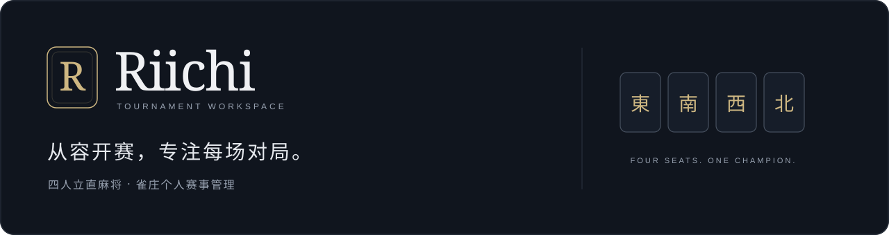
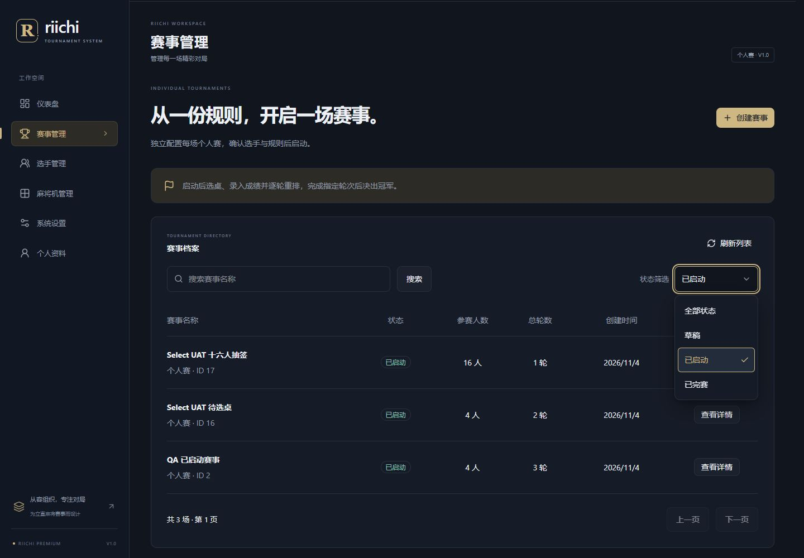
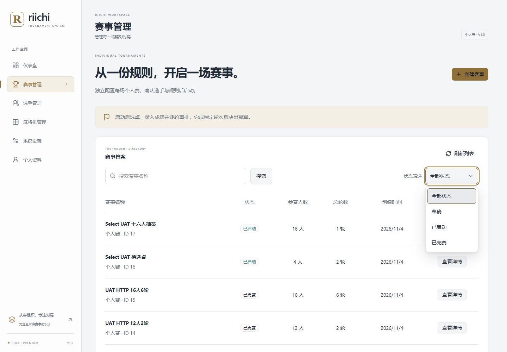

<p align="center">
  
</p>

<p align="center">
  <strong>面向雀庄老板的四人立直麻将个人赛事管理系统</strong>
</p>

<p align="center">
  
</p>

<p align="center">
  <a href="#快速启动">快速启动</a> ·
  <a href="#界面预览">界面预览</a> ·
  <a href="docs/local-development.md">开发文档</a> ·
  <a href="docs/F0-06-functional-spec.md">赛事规则</a>
</p>

---

## 关于 Riichi

从一份参赛名单，到最后一位冠军。Riichi 帮助雀庄管理员维护选手与物理桌、组织比赛、确认成绩，并留存清晰的赛事档案。

选手无需注册或登录。管理员在一个工作空间完成 **建档 → 开赛 → 分桌 → 录分 → 冠军归档**，让现场组织回归对局本身。

## 界面预览

### 深海军蓝 · 赛事工作空间



### 中性浅色 · 赛事档案



<sub>截图来自真实应用的隔离测试环境，使用测试资料，不代表实际运营记录。界面支持深浅主题及手机布局。</sub>

## 核心功能

| 能力 | 使用场景 |
| --- | --- |
| 选手档案 | 管理员新增、编辑、搜索、归档及恢复选手；保护已有关联赛事 |
| 物理桌台账 | 管理设备编号、状态与位置；单场选择 1～4 张真实物理桌 |
| 独立个人赛事 | 支持 4 / 8 / 12 / 16 人、1～6 轮，配置开局点数、返还原点、Uma 与头名赏（可为 0） |
| 成绩录入与更正 | 输入时实时试算积分，赛事进行中可更正前轮成绩并保留记录，完赛后只读 |
| 轮次与座次 | 首轮随机分桌，后续按累计表现重排；每轮重新随机四风 |
| 精确计分 | 录入整数终局点数，草稿与正式确认分离；有理数计算与无损保存 |
| 冠军与归档 | 累计榜、同分决胜及必要的公开抽签；完赛锁定结果并释放物理桌 |

完整规则与异常处理以[赛事功能规范](docs/F0-06-functional-spec.md)为准。

## 技术架构

前后端分离的模块化单体，围绕赛事组织保留清晰边界。

| 层级 | 技术 |
| --- | --- |
| 后端 | Python 3.13 · Django 5.2 LTS · Django REST Framework |
| 前端 | React · TypeScript · Vite |
| 界面 | Tailwind CSS · shadcn/ui · Radix UI · Lucide |
| 数据 | SQLite 本地开发；PostgreSQL 生产 |
| 生产入口 | Caddy 自动 HTTPS → Nginx 静态资源与 API 代理 |
| 会话与计分 | Django Session / CSRF · Fraction 精确计分 |

依赖精确版本见 [requirements.txt](backend/requirements.txt) 和 [package-lock.json](frontend/package-lock.json)。更多设计见[架构文档](docs/architecture.md)。

## 快速启动

### Windows

先准备 **Python 3.13**（最低补丁版本见 [版本声明](backend/.python-version)）、**Node.js ≥22.12** 与 **npm ≥10**。

1. 克隆仓库：

   ```powershell
   git clone https://github.com/kaleidoscopezzz/Riichi.git
   cd Riichi
   ```

2. 双击根目录 **`start.bat`**。
3. 按提示完成首次环境准备；需要迁移时，先确认目标数据库与备份，再明确同意。
4. 浏览器自动打开 [Riichi 本地工作空间](http://127.0.0.1:5173)。首次使用按提示交互运行 `init_admin`，没有默认管理员密码。
5. 退出时双击 **`stop.bat`**。关闭启动窗口不会停止服务。

<a id="uat-fix-01选手维护与-admin-初始化"></a>

后续启动会复用满足锁定版本的依赖；重复启动复用现有服务。端口被其他程序占用时会明确报错，不终止占用者。配置、管理员初始化、日志及常见问题见[本地运行文档](docs/local-development.md)。

后端健康接口：[127.0.0.1:8000/api/v1/health/](http://127.0.0.1:8000/api/v1/health/)。启动器仅用于本地开发与演示，不是公网生产部署方案。

### Linux / macOS

使用[手动启动说明](docs/local-development.md#linux--macos手动运行)，分别运行 Django 与 Vite。

Linux 服务器生产部署请使用 [Docker Compose 部署指南](docs/deployment-linux.md)，上线进度与已验证范围见[生产交付记录](docs/project/production-launch-verification.md)。

## 使用流程

1. 管理员登录，维护有效选手和可用物理桌。
2. 创建个人赛事，确认名单、轮数及计分规则后启动。
3. 选择固定物理桌，生成首轮座次。
4. 逐桌录入终局点数；核对后正式确认，再生成下一轮。
5. 完成所有轮次，处理必要的公开抽签并确认完赛，查看冠军与只读档案。

## 项目目录

```text
Riichi/
├── backend/          # Django API、领域模块与测试
├── frontend/         # React 工作空间
├── assets/           # 品牌素材与产品截图
├── scripts/          # Windows 本地启动与进程管理
├── docs/             # 需求、架构、运行及验证文档
├── start.bat         # Windows 一键启动
├── stop.bat          # 停止本次启动的服务
└── AGENTS.md         # 开发约束
```

## 开发与测试

在已准备环境、并已为数据库检查选择隔离库后执行：

```powershell
Set-Location backend
.\.venv\Scripts\python.exe manage.py check
.\.venv\Scripts\python.exe manage.py test

Set-Location ../frontend
npm run typecheck
npm test
npm run build
```

更多迁移、配置和检查命令见[开发文档](docs/local-development.md#开发与检查)。设计约束见 [AGENTS.md](AGENTS.md)，需求入口见[需求总览](docs/requirements.md)。

## 支持范围与限制

- 当前面向雀庄管理员，仅支持四人立直麻将个人赛；选手没有自助注册或登录入口。
- 已确认成绩保持只读，赛事启动后冻结名单与规则；不提供任意积分公式或补正入口。
- 公开抽签由现场完成后记录、复核，系统不代替真实抽签。
- 微信、团体赛、密码找回等未纳入当前范围。
- 本地启动、容器验证和真实生产上线分别验收；当前实测平台及未验证项见[生产交付记录](docs/project/production-launch-verification.md)。
